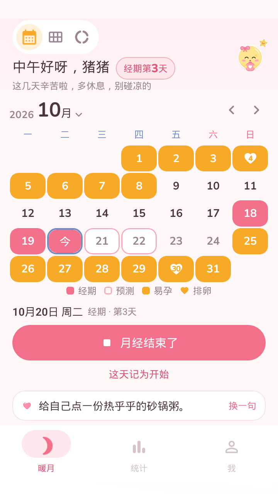
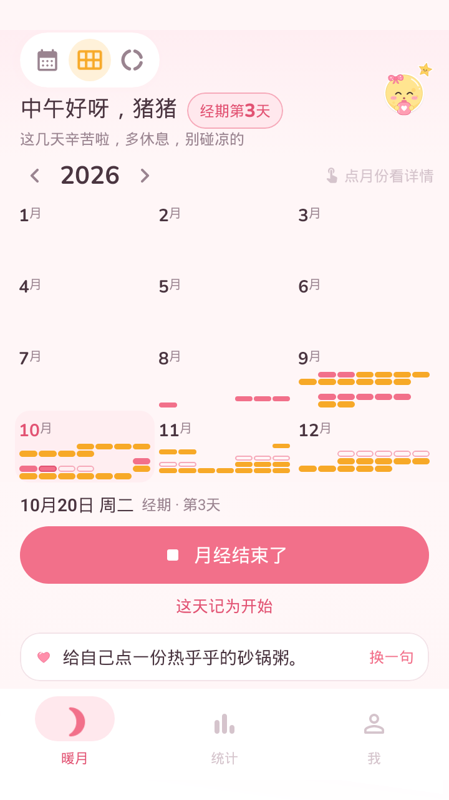
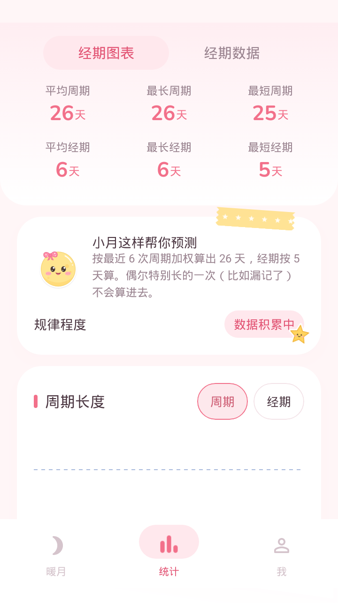

# 暖月

安卓经期记录 App。记开始和结束，按最近几次周期预测下一次、排卵日和易孕期，临近时提醒。伴侣可以用邀请码只读查看。

<p>
  
  
  
</p>

## 功能

- 月历、整年、周期环三种视图
- 预测取最近 6 次周期加权平均，漏记造成的异常周期会剔除
- 提醒：经期前 N 天、当天、推迟、该结束了、易孕期和排卵日；重启后自动恢复
- 统计平均、最长、最短的周期和经期
- 桌面小组件，2×2 和 4×2 两种
- 邀请码同步：本人可写，伴侣只读；端到端加密，服务器只存密文
- 离线可用，应用内更新

只记经期本身，不记心情和症状。预测仅供参考，不能用于避孕。

## 构建

需要 JDK 17 和 Android SDK 35。

```bash
cd android
./gradlew testDebugUnitTest
./gradlew assembleDebug
```

界面截图测试用 Paparazzi，改了界面后用 `./gradlew recordPaparazziDebug` 更新 `src/test/snapshots`。

同步服务是 FastAPI + SQLite：

```bash
cd server
pip install -r requirements.txt pytest httpx
python -m pytest -q test_app.py
```

站点地址写在 `deploy/private/site.env`，不在仓库里；构建时读取；没有这个文件也能编译，只是同步和应用内更新用不了。

## 目录

```
android/   Kotlin + Jetpack Compose + Room
server/    同步服务和下载页
art/       吉祥物、贴纸的 SVG 源文件，短语原稿
deploy/    部署脚本、systemd、nginx 模板
docs/      HANDOFF.md：设计、同步协议、运维和历次改动
```

## 部署

```bash
(cd android && ./gradlew assembleRelease)
./deploy/deploy.sh deploy/private/server_id_rsa android/app/build/outputs/apk/release/app-release.apk
```

细节见 [docs/HANDOFF.md](docs/HANDOFF.md)。
